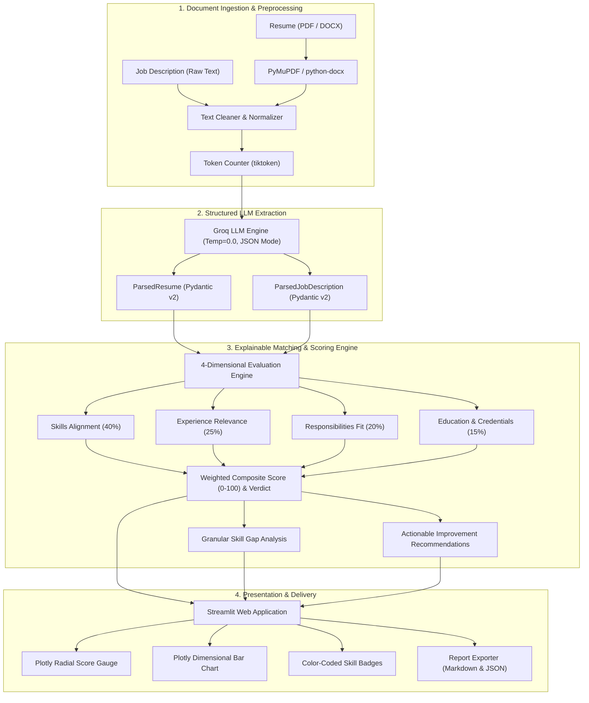

<div align="center">

# ⚡ TalentMatch AI
### Enterprise AI Resume Parser & Intelligent Job Matcher

[](https://www.python.org/)
[](https://streamlit.io/)
[](https://groq.com/)
[](https://docs.pydantic.dev/)
[](https://pytest.org/)
[](LICENSE)

*An autonomous, explainable AI platform that parses resumes, analyzes job descriptions, calculates mathematical candidate-job alignment, identifies critical skill gaps, and generates strategic optimization feedback.*

---

[Key Features](#-key-features) • [Problem & Solution](#-the-problem--the-solution) • [System Architecture](#-system-architecture) • [Tech Stack](#-technology-stack) • [Scoring Methodology](#-mathematical-scoring-methodology) • [Quickstart](#-quick-start-guide) • [Project Structure](#-project-structure)

---

</div>

## 📌 The Problem & The Solution

### 🚨 The Problem: Flaws of Traditional ATS & Screening
Modern recruitment pipelines are overwhelmed by application volumes, leading organizations to rely heavily on legacy **Applicant Tracking Systems (ATS)**. However, traditional screening systems suffer from critical limitations:
1. **Rigid Keyword Matching:** Traditional filters look for verbatim keyword matches (e.g., searching for `"FastAPI"` but rejecting a candidate with `"Python asynchronous REST APIs"`).
2. **Loss of Context & Seniority:** Word frequency cannot evaluate depth, quantifiable impact, business outcomes, or genuine seniority.
3. **Black-Box Decision Making:** Candidates receive automated rejections without actionable feedback on what skills or metrics they lacked.
4. **Layout Fragility:** Tables, multi-column designs, and diverse formats (`.pdf`, `.docx`) frequently break legacy parsers.

### 💡 The Solution: Context-Aware Talent Intelligence
**TalentMatch AI** transforms resume evaluation from brittle keyword scanning into **context-aware semantic intelligence**:
- **Multi-Format Extraction:** Automatically processes both `.pdf` and `.docx` formats, extracting text from tables, headers, and complex layouts.
- **Sub-Second LLM Parsing:** Powered by **Groq Cloud LPUs** operating with deterministic JSON Mode (`temperature=0.0`) to extract structured candidate profiles and job requirements.
- **Strict Data Contracts:** Protected by **Pydantic v2** validation with custom pre-validators, alias mapping, and null-safety to prevent schema crashes.
- **Explainable 4-Dimensional Scoring:** Employs a transparent mathematical formula weighting Skills, Experience, Responsibilities, and Education (0–100) with categorical verdicts.
- **Granular Skill-Gap Analysis:** Categorizes skills into Matched Mandatory, Matched Preferred, Missing Critical Gaps, and Candidate Proficiencies.
- **Actionable Coaching:** Generates ATS optimization tips, metric reframing guidance, and targeted interview preparation questions.

---

## 🌟 Key Features

- **Document Ingestion:** High-fidelity text extraction supporting **PDF** (`PyMuPDF`) and **Word** (`python-docx`).
- **Text Normalization Engine:** Strips non-printable characters, cleans unicode formatting (NFKC), and standardizes non-standard bullets into uniform markdown.
- **Real-Time Token Budgeting:** Built-in `tiktoken` counter monitors token consumption and protects LLM context windows.
- **Dynamic Model Discovery:** Automatically detects and queries active models available on your Groq Cloud account (`openai/gpt-oss-120b`, `llama-3.3-70b-versatile`, `qwen/qwen3.8-27b`).
- **Interactive Visual Analytics:** Streamlit UI styled with glassmorphism CSS, featuring Plotly radial score gauges and horizontal dimensional bar charts.
- **Multi-Format Export:** Download evaluation reports as formatted **Markdown (`.md`)** or machine-readable **JSON (`.json`)**.
- **Automated Verification:** 21 automated unit tests across document extractors, text sanitizers, data schemas, scoring math, and report generators.

---

## 🏗️ System Architecture

The following diagram illustrates the complete end-to-end data processing lifecycle:



---

## 💻 Technology Stack

| Layer | Technology | Purpose & Justification |
| :--- | :--- | :--- |
| **Language** | **Python 3.11+** | Modern type hints, high performance, and broad ecosystem support. |
| **AI / LLM Engine** | **Groq Cloud API & SDK** | Sub-second LPU inference speeds for real-time extraction and analysis. |
| **LLM Models** | **`openai/gpt-oss-120b` / `llama-3.3-70b`** | High-reasoning parameter models running with `temperature=0.0` in JSON mode. |
| **Data Validation** | **Pydantic v2** | Strict data modeling, custom pre-validators, alias choices, and null-safety. |
| **Document Processing** | **PyMuPDF (`fitz`)** | Fast, high-accuracy native PDF text extraction. |
| **Word Processing** | **`python-docx`** | Extraction of paragraphs, headers, and tabular cells from `.docx` files. |
| **Web Dashboard** | **Streamlit** | Interactive Python-native frontend framework. |
| **UI Styling** | **Custom Glassmorphic CSS** | High-contrast modern interface with responsive card layouts and badges. |
| **Visualizations** | **Plotly Graph Objects** | Interactive radial score gauges and horizontal dimensional bar charts. |
| **Token Budgeting** | **`tiktoken`** | Exact token counting to monitor and preserve LLM context budget. |
| **Unit Testing** | **`pytest`** | Automated testing suite with 21 unit tests covering all modules. |

---

## 📊 Mathematical Scoring Methodology

To eliminate arbitrary AI hallucination, the evaluation score is calculated using a **deterministic, weighted mathematical algorithm**:

$$\text{Overall Score} = (S_{\text{skills}} \times 0.40) + (S_{\text{experience}} \times 0.25) + (S_{\text{responsibilities}} \times 0.20) + (S_{\text{education}} \times 0.15)$$

### Dimensional Breakdown

1. **Skills Alignment ($40\%$ Weight):** Measures coverage of mandatory technical competencies, platforms, and bonus/preferred tools.
2. **Experience Relevance ($25\%$ Weight):** Evaluates career trajectory, demonstrated seniority, domain track record, and years of experience.
3. **Responsibilities Fit ($20\%$ Weight):** Evaluates demonstrable past execution of day-to-day duties and core deliverables.
4. **Education & Credentials ($15\%$ Weight):** Evaluates academic degree alignment, certifications, and licenses.

### Categorical Verdict Matrix

| Composite Score | Categorical Verdict | Recommendation Summary |
| :---: | :---: | :--- |
| **85.0 – 100.0** | `Strong Match` | Top candidate; meets or exceeds mandatory skills and experience. Fast-track to interview. |
| **70.0 – 84.9** | `Good Match` | Competitive candidate with strong core fundamentals; minor gaps in preferred skills. |
| **55.0 – 69.9** | `Potential Match` | Baseline qualifications met; explore growth potential and specific gaps in interview. |
| **40.0 – 54.9** | `Moderate Match` | Notable deficits in key technical proficiencies or years of relevant experience. |
| **0.0 – 39.9** | `Low Match` | Substantial misalignment with core job requirements. |

---

## 📂 Project Structure

```
TalentMatch-AI/
├── .env.example               # Template for environment variables
├── .gitignore                 # Excludes .env, virtual environments, and cache
├── README.md                  # Complete project documentation
├── requirements.txt           # Pinned production dependencies
├── config.py                  # Environment loader & configuration settings
├── app.py                     # Streamlit frontend entrypoint
│
├── core/                      # Modular backend domain logic
│   ├── __init__.py
│   ├── analyzer.py            # Evaluation coordinator & mathematical scoring
│   ├── document_parser.py     # PDF & DOCX text extraction engines
│   ├── groq_service.py        # Official Groq SDK client wrapper & fallback logic
│   ├── prompts.py             # System prompts for extraction and matching
│   ├── report_generator.py    # Exporters for Markdown and JSON reports
│   ├── samples.py             # Built-in demo resumes and job descriptions
│   ├── schemas.py             # Pydantic v2 data models with validators
│   ├── text_cleaner.py        # Unicode sanitization and bullet normalization
│   └── token_counter.py       # Tiktoken & heuristic token counter
│
├── ui/                        # Presentation & visual components
│   ├── __init__.py
│   ├── components.py          # Plotly radial gauge, bar charts, and badges
│   └── styles.py              # Custom glassmorphic CSS stylesheet
│
└── tests/                     # Automated test suite (pytest)
    ├── __init__.py
    ├── test_analyzer.py        # Tests for scoring math and consistency
    ├── test_document_parser.py # Tests for PDF & DOCX in-memory extraction
    ├── test_report_generator.py# Tests for Markdown & JSON exports
    ├── test_schemas.py         # Tests for Pydantic models & validation rules
    ├── test_text_cleaner.py    # Tests for text sanitization
    └── test_token_counter.py   # Tests for token estimation
```

---

## 🚀 Quick Start Guide

### 1. Clone the Repository
```bash
git clone https://github.com/mahajanshakshi/TalentMatch-AI.git
cd TalentMatch-AI
```

### 2. Create and Activate a Virtual Environment
```bash
# Windows
python -m venv .venv
.\.venv\Scripts\Activate.ps1

# macOS / Linux
python3 -m venv .venv
source .venv/bin/activate
```

### 3. Install Dependencies
```bash
pip install --upgrade pip
pip install -r requirements.txt
```

### 4. Configure Your API Key
Create a `.env` file from the example template:
```bash
cp .env.example .env
```
Open `.env` and add your Groq Cloud API key ([Get a free key here](https://console.groq.com/keys)):
```env
GROQ_API_KEY=gsk_your_actual_groq_api_key_here
GROQ_MODEL=openai/gpt-oss-120b
```

### 5. Launch the Application
```bash
streamlit run app.py
```
Open your browser at `http://localhost:8501`.

---

## 🧪 Running Automated Tests

Run the complete test suite using `pytest`:

```bash
pytest tests/ -v
```

Expected output:
```
============================= test session starts =============================
collected 21 items

tests/test_analyzer.py::test_verdict_calculation PASSED                  [  4%]
tests/test_analyzer.py::test_enforce_score_consistency PASSED            [  9%]
tests/test_analyzer.py::test_analyzer_mock_pipeline PASSED               [ 14%]
tests/test_document_parser.py::test_extract_pdf_success PASSED           [ 19%]
tests/test_document_parser.py::test_extract_docx_success PASSED          [ 23%]
tests/test_document_parser.py::test_extract_resume_text_dispatcher PASSED [ 28%]
tests/test_document_parser.py::test_unsupported_file_extension PASSED    [ 33%]
tests/test_document_parser.py::test_empty_document PASSED                [ 38%]
tests/test_report_generator.py::test_generate_markdown_report PASSED     [ 42%]
tests/test_report_generator.py::test_generate_json_report PASSED         [ 47%]
tests/test_schemas.py::test_contact_info_valid PASSED                    [ 52%]
tests/test_schemas.py::test_dimension_score_boundaries PASSED            [ 57%]
tests/test_schemas.py::test_verdict_fuzzy_matching PASSED                [ 61%]
tests/test_schemas.py::test_match_analysis_report_serialization PASSED   [ 66%]
tests/test_text_cleaner.py::test_clean_text_basic PASSED                 [ 71%]
tests/test_text_cleaner.py::test_clean_text_bullet_normalization PASSED  [ 76%]
tests/test_text_cleaner.py::test_clean_text_control_characters PASSED    [ 80%]
tests/test_text_cleaner.py::test_clean_text_empty_and_none PASSED        [ 85%]
tests/test_text_cleaner.py::test_clean_text_truncation PASSED            [ 90%]
tests/test_token_counter.py::test_token_counter_empty PASSED             [ 95%]
tests/test_token_counter.py::test_token_counter_text PASSED              [100%]

============================= 21 passed in 1.25s ==============================
```

---

## 🔒 Security & Data Privacy

- **Zero Data Retention:** Resumes and job descriptions are processed directly in-memory and are never stored or logged permanently.
- **Credential Protection:** Secrets are loaded strictly via environment variables; `.env` is permanently excluded via `.gitignore`.
- **Deterministic Sandboxing:** LLM interactions run with zero-temperature JSON mode to prevent prompt injection or non-deterministic execution paths.

---

## 👩‍💻 Author

**Shakshi Mahajan**  
- GitHub: [@mahajanshakshi](https://github.com/mahajanshakshi)
- Repository: [TalentMatch-AI](https://github.com/mahajanshakshi/TalentMatch-AI)

---

## 📄 License

This project is open-source and licensed under the [MIT License](LICENSE).
